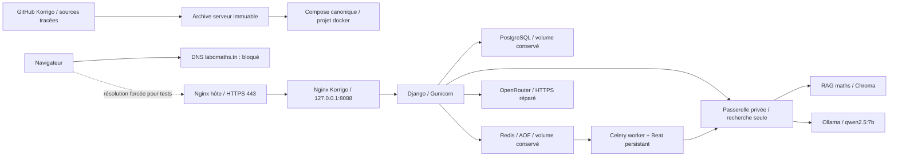

# Korrigo — état des lieux et remise en service du 12 octobre 2026

Intervention autorisée par le propriétaire : audit Git/local/GitHub/serveur, corrections, amélioration et mise en service. Aucune donnée d’examen ne doit être supprimée. Les vérifications finales sont consignées ci-dessous après déploiement.

## Cartographie

| Élément | Emplacement et rôle |
|---|---|
| Dossier de travail principal | `/home/alaeddine/Bureau/KORRIGO/korrigo_v2_improved` : vrai dépôt Git ; le dossier parent KORRIGO n’est pas un dépôt. |
| GitHub | https://github.com/cyranoaladin/Korrigo ; branche de correction `fix/prod-remediation-20261012`. |
| Travail isolé | `/home/alaeddine/.config/superpowers/worktrees/Korrigo/prod-remediation-20261012` ; les documents officiels non suivis du dépôt principal sont préservés. |
| Ancien miroir local | `korrigo_prod` : historique sans Git, réservé à la consultation. |
| Serveur | `root@88.99.254.59`, partagé avec d’autres applications. |
| Source serveur canonique | Archive du commit publié dans `/var/www/labomaths/korrigo_releases/<commit>` ; révision exacte consignée dans `candidate-manifest.json` et `ops/ACTIVE_RELEASE.md`. Les sources des images sont détaillées ci-dessous. |
| Pointeur de production | `/var/www/labomaths/korrigo_current`. |
| Ancien dépôt serveur | `/var/www/labomaths/korrigo_release` : branche divergente, HEAD initial `6131bd4`, modifications et anciens overrides conservés ; à ne plus utiliser pour déployer. |
| Ancienne configuration | `/var/www/labomaths/korrigo/.env` : lien vers la configuration canonique après bascule. |
| Configuration canonique | `infra/docker/docker-compose.prod.yml` de la version active et `/etc/korrigo-ops/runtime.env`, permissions root uniquement. |
| Commande d’exploitation | `/opt/korrigo-ops/korrigo-compose` ; aucun override historique nécessaire. |
| Point de restauration | `/var/lib/korrigo-ops/remediation-20261012`, root uniquement ; configurations, ancien état, dump PostgreSQL et preuves. |



## Constats initiaux

- Git local/GitHub sur `4e85f49`, serveur divergent et images issues de plusieurs versions. Le Compose seul pouvait abandonner des correctifs et le calendrier Beat persistant.
- Les six conteneurs étaient sains ; cela ne vérifiait pas les connexions IA. Le backend ne pouvait pas sortir en HTTPS à cause de règles Docker référant un ancien pont.
- OCR : modèle OpenRouter vide ; source locale privée de la migration initiale identification présente dans l’image déployée.
- RAG : mauvais token et mauvais accès réseau ; collections mathématiques attendues absente et vide. Les corpus NSI existants ne doivent pas servir de remplacement silencieux.
- Redis : stockage anonyme non explicite, RDB sans AOF, politique `allkeys-lru` pouvant évincer des données utiles aux tâches.
- Dépendances : Django 4.2 hors support ; audit frontend initial : 53 vulnérabilités connues.
- Le DNS public renvoyait NXDOMAIN, alors que HTTPS répondait correctement avec le nom attendu forcé vers le serveur. Le registre ATI indiquait **Pending cancel**, registrar **OVH**. Ce statut doit être traité avec le registrar, sans conclure à une récupération automatique. [WHOIS ATI](https://whois.ati.tn/index.php)

## Corrections livrées

- Règles HTTPS ciblées sur le réseau Korrigo, idempotentes, réappliquées par `korrigo-egress-repair.timer`. Lors d'un changement de pont/subnet, seules les anciennes règles portant les trois tags réservés à ce helper sont retirées, après établissement des nouvelles. Aucune politique globale ni autre projet Docker redémarré.
- Migration identification restaurée à l’identique ; modèle OCR explicite ou valeur adaptée au fournisseur.
- Django 5.2.18, DRF 3.18.3, Gunicorn 26.2.0, Pillow 12.3.0 et dépendances corrigées. Audit Python sans exceptions masquant des CVE. [Django 5.2.18](https://docs.djangoproject.com/en/5.2/releases/5.2.18/)
- Dépendances frontend sécurisées ; installation reproductible `npm ci`, Node 22.23.3 et Nginx 1.30.5.
- Enseignant sans affectation : tableau de bord vide utilisable et déconnexion disponible. La fenêtre de sélection restait auparavant bloquante quand aucun type d'examen n'était disponible ; le correctif préserve chargement, erreurs et choix entre matières.
- Compose unique : images applicatives obligatoires, références d’images explicites, données et calendrier Beat conservés.
- Redis AOF activé d’abord sur l’instance vivante, réécriture vérifiée, puis volume existant conservé et politique `noeviction`.
- Passerelle privée RAG/Ollama : aucun port hôte ; recherche RAG authentifiée, aucun endpoint d’ingestion/suppression accessible à Korrigo. La clé administrative RAG reste côté passerelle.
- Corpus maths : 78 fragments DNB et 107 Première, quatre références ministérielles ; version 2025–2026 explicite pour les copies existantes. Les collections NSI, français et éducation restent inchangées. Les programmes de Première entrés en vigueur en 2026 doivent être distingués lors de futures importations.
- Modèles configurés : OCR `openai/gpt-4o-mini`, bilans `anthropic/claude-haiku-4.5`, secours local `qwen2.5:7b`.
- Secrets Django, DB, Redis, métriques, sauvegardes et recherche RAG renouvelés et vérifiés. Ancienne clé de sauvegarde conservée dans le point de restauration pour déchiffrer les archives historiques. Le changement de secret Django peut nécessiter une reconnexion des utilisateurs.

## Images de production

Backend : `433f4122ec0ad113728cbca408d50d1cfb449649`. Frontend : `364a34fa863341ab5c4e60cd60886f30fe48a385`. Helper réseau déployé : `88ed67b`. Les commits suivants documentent ces versions sans changer leur code exécutable. Comparaison indépendante de **247 fichiers Python exécutables : aucune différence** entre image et archive Git. Les identifiants ci-dessous sont les identifiants de contenu vérifiés sur le serveur, utilisables sans registre ; les couches chargées et les images antérieures sont conservées.

| Service | Image ID serveur |
|---|---|
| Backend, worker, Beat | `sha256:c72362ae9a3dd471abb84921c0e8589dd6b2a481cb99e84b5f4d1b77f368d872` |
| Frontend Nginx | `sha256:d37545f291c4be8d84a8d450188ea566073c17f0bfa2bbf842d0f4d6d524dba6` |
| Passerelle | `sha256:0985e772fb9f729e6fa0980da05fca5d9c468e870eed43071545afa9d2e27d94` |

## Vérifications

Backend : lot rapide SQLite 1 031 tests passés, 1 ignoré et 3 désélectionnés par les marqueurs habituels ; puis **lot complet PostgreSQL 1 037 tests passés et 6 sous-tests passés, aucun ignoré**, incluant concurrence, défauts SQL, grands PDF et deux nouveaux contrats CI. Frontend **368 tests passés**, compilation, contrôle des types et build Docker réussis. Audits pip/npm : aucune vulnérabilité connue ; Trivy sur l'archive Git : aucune vulnérabilité HIGH/CRITICAL dans les manifests analysés. Lint frontend : aucune erreur, 4 095 avertissements préexistants avant le correctif final ; lint des deux composants modifiés sans erreur. Scripts d’exploitation : **20 tests passés**, dont HTTP réel avec Nginx en lecture seule. Revue indépendante sans P0/P1 restant.

Contrôle de release corrigé : le lot complet utilise les réglages PostgreSQL de la stack CI dédiée, sans exclusion de marqueurs. La détection des résumés avec des tests ignorés a été reproduite puis corrigée ; un nombre strictement positif bloque la release. Ce script réinitialise et peuple une stack isolée de validation : il ne doit pas être exécuté sur la stack de production ou sur un Docker partagé.

Préflight serveur : images présentes, versions/source vérifiées, montages DB/Redis/app comparés aux volumes vivants, `check --deploy`, `migrate --check`, `makemigrations --check --dry-run` réussis, aucune migration de données requise.

Après bascule principale :

- Sept services sains, aucun redémarrage automatique ni arrêt pour manque de mémoire observé ; worker Celery joignable et Beat avec calendrier persistant.
- 52 fichiers statiques de l'image web déployée comparés au build local : aucune différence. Archive frontend : 958 fichiers Git comparés indépendamment, aucune différence.
- **733 copies contrôlées, zéro anomalie**, migrations à jour, cache accessible. Aucun compte existant ni copie supprimés. Les trois comptes et le profil élève créés exclusivement pour les essais ont été retirés avec leurs sessions après validation : comptes revenus à 771, élèves à 759, copies toujours 733. Les journaux des essais sont conservés sans association aux comptes supprimés.
- RAG DNB et Première : recherches réussies avec documents officiels ; inférence OpenRouter, secours Ollama, OCR Tesseract et OCR Vision testés sur des données synthétiques, tous réussis.
- **17 routes publiques vérifiées au navigateur**, desktop/mobile, sans erreur JavaScript ni ressource défectueuse. Administrateur, enseignant et élève : connexion, rôle, tableau de bord, rechargement, gardes et déconnexion validés, **24/24 points, 8 par rôle**. Enseignant sans affectation : API des types HTTP 200, liste vide, aucun modal bloquant et déconnexion HTTP 200 après le correctif.
- Dix contrôles HTTPS de disponibilité : tous HTTP 200, médiane 297,9 ms et maximum 301,8 ms. Résolution du nom forcée vers le serveur ; certificat TLS vérifié normalement.
- Sauvegarde chiffrée déclenchée via le vrai worker Celery après rotation, succès, environ 4,6 Mo. Archives nouvelle et historique déchiffrées et contrôlées par `pg_restore --list`, sans conserver de dump temporaire en clair.
- Métriques HTTPS : HTTP 403 sans token/avec token erroné, HTTP 200 avec le nouveau token ; routage et protection vérifiés.
- Timers réseau, sauvegardes DB/médias, surveillance Beat et Certbot actifs. Les mesures décrivent l'état observé après intervention ; elles ne remplacent pas la surveillance continue.
- Capacité hôte observée : charge à une minute 0,92, environ 53 Go de mémoire disponible et 281 Go de disque libre (69 % utilisés). Aucun signe de saturation lors des essais ; ces ressources sont partagées avec les autres applications du serveur.

## Exploitation et retour arrière

```sh
/opt/korrigo-ops/korrigo-compose ps
/opt/korrigo-ops/korrigo-compose logs --since 15m backend celery celery-beat
systemctl status korrigo-egress-repair.timer
curl --resolve korrigo.labomaths.tn:443:88.99.254.59 https://korrigo.labomaths.tn/api/health/
```

Les sorties de `docker inspect`, `docker compose config` et les fichiers `.env` contiennent des secrets : les conserver dans des fichiers privés sur le serveur, sans les publier dans un terminal partagé ou Git.

Retour arrière des images : `/var/lib/korrigo-ops/remediation-20261012/rollback-images.sh`. Il rétablit d’abord DB/Redis et garantit les nouveaux identifiants, puis remet les anciennes images applicatives. Les nouveaux secrets et toutes les données sont conservés. Aucune migration irréversible n’est appliquée.

Sauvegarde immédiate avant intervention : dump PostgreSQL vérifié, 4 950 548 octets. Les sauvegardes/restaurations hors site DB et médias étaient déjà contrôlées ; leurs volumes sont conservés. L’ancien calendrier Beat et la clé GPG historique restent disponibles.

Preuves privées : `candidate-manifest.json`, `image-source-verification.json`, `frontend-rollout-verification.json`, `backup-decryption-verification.json` dans le point de restauration ; preuve du corpus dans `/opt/korrigo-ops/20261012/math-rag-restoration-evidence.json`. Ces fichiers ne doivent pas être remplacés par des sorties non filtrées des environnements.

## Actions externes restantes

1. **OVH/ATI : rétablir labomaths.tn**, sa délégation DNS et l’enregistrement A Korrigo vers `88.99.254.59`. Vérifier ensuite les serveurs autoritatifs, deux résolveurs indépendants, l’accès ordinaire et le renouvellement TLS. Certificat actuellement valable jusqu’au 24 novembre 2026 ; le timer Certbot est actif, mais une délégation DNS valide est nécessaire aux validations HTTP.
2. **OpenRouter : remplacer la clé d’inférence exposée pendant le diagnostic**, mettre à jour uniquement le secret serveur puis révoquer l’ancienne clé après test. Aucun accès de gestion trouvé. Une clé d’inférence ne permet pas de créer une nouvelle clé administrative. [Gestion des clés OpenRouter](https://openrouter.ai/docs/guides/overview/auth/management-api-keys)

Ne pas déclarer le domaine publiquement rétabli tant que ces vérifications DNS n’ont pas passé. Les tests avec résolution forcée prouvent le fonctionnement du serveur et de TLS, pas l’accès Internet ordinaire.
